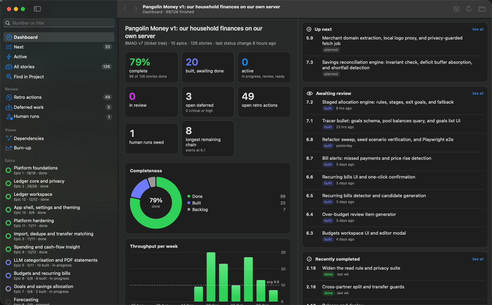
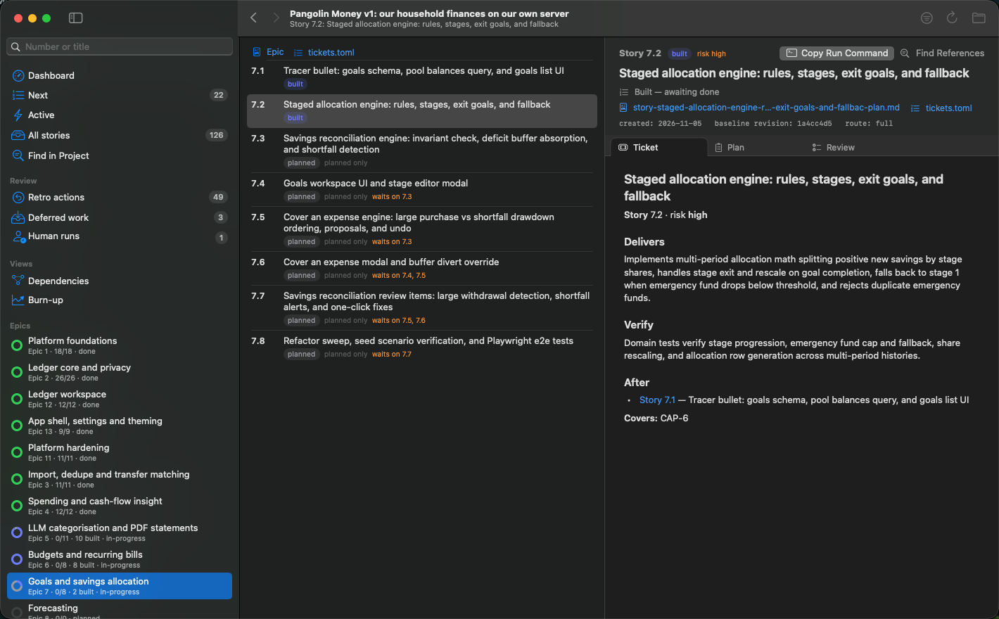

# BMAD Viewer

A lightweight native macOS viewer for [BMAD Method](https://github.com/bmad-code-org/BMAD-METHOD) projects.

A BMAD project keeps its whole plan on disk — epics, tickets, plans, retros —
as markdown and a few toml files. That is the method's strength and, around
story eighty, its fog. BMAD Viewer reads the tree the way the method's own
scripts do and answers the questions you actually open it for: how far along
are we, what is next, what is waiting on *me*, and what does the remaining work
look like as one chain.

SwiftUI shell, AppKit text view (TextKit 1) for documents, no web view. It
reads the project and its git history; it never edits the plan — a build, a
review sign-off, a deferred-work entry all stay yours to make.

## What you get

- **A dashboard that tells the truth.** Percent complete, built awaiting done,
  in review, the longest remaining chain — beside Up next, Awaiting review and
  Recently completed cards whose dates come from a git replay, not wishful
  thinking.
- **Every ticket as it actually stands.** Status, risk, what it waits on, its
  plan and findings side by side — and the sidebar rings that show an epic half
  done and half built *looking* that way.
- **One-click handoff, never a hand in the till.** The viewer does not build
  anything. **Copy Run Command** puts the exact `/bmad-build ticket 12.1` line
  on your clipboard, ready to paste into a fresh agent chat.
- **A review tab that matches the commit.** Diffs from the story's recorded
  baseline to its own commit, the review order's stops highlighted, the story's
  `verify` checklist tickable — and **Mark Review Complete** shows every line
  it will change before it changes any.
- **Fast, offline, native.** ⌘K finds any story, ticket, retro action, deferred
  entry or tracked file in about 25 ms; ⌘⇧F greps the project in about a
  tenth of a second.

## Get started

Download the latest **`BmadViewer-*.dmg`** from
[Releases](https://github.com/sbwilson/BmadViewer/releases), drag the app to
Applications, and open it — the build is signed ad-hoc, so the first launch
wants right-click → Open once. Release builds keep themselves current
(Check for Updates…, via [Sparkle](https://sparkle-project.org/)).

Then **File › Open Project…** (⌘O) and pick a BMAD project root. Both layouts
are read — the v6 `sprint-status.yaml` world and the v7 ticket tree — with
sources documented in [using the app](docs/using-the-app.md).

## Where things are

| | |
| --- | --- |
| [Using BMAD Viewer](docs/using-the-app.md) | what it reads, reviewing, handoff, views, shortcuts — everything the app does |
| [Development](docs/development.md) | building, running, `--dump` diagnostics, releasing, the Sparkle key |
| [Roadmap](roadmap.md) | where this is going, and what is already Done |

`BmadViewer --dump <project>` prints what was read from the terminal, no window
required.

## Not yet

- Tracker-backed ticket stores (`store` other than `repo`): `tracker_status` is read from leaf files, but nothing is synced.
